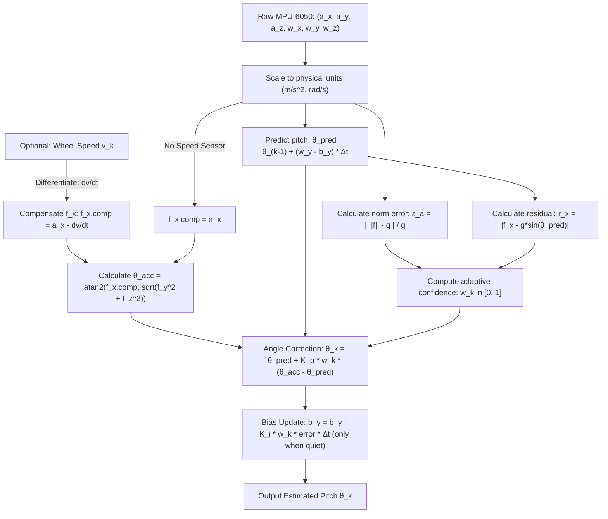

# Bike Pitch Angle Estimation Algorithm using MPU-6050

This document defines the mathematical formulation and sensor fusion algorithm for determining the real-time pitch angle ($\theta$) of a bicycle equipped with an MPU-6050 6-DOF IMU (3-axis accelerometer + 3-axis gyroscope), specifically addressing the false-pitch error caused by bike acceleration and braking.

---

## 1. Coordinate Frames & Conventions

### 1.1 Sensor & Body Frame $\{B\}$
Mount the MPU-6050 rigidly to the bike frame with the following right-handed body frame convention:
* **$X_B$ (Longitudinal)**: Points forward in the direction of travel.
* **$Y_B$ (Lateral)**: Points to the rider's left (or right, consistent with standard vehicle dynamics; here we define **$Y_B$ = Left**).
* **$Z_B$ (Vertical)**: Points upwards perpendicular to the road plane.

```
       Z_B (Up)
        ^
        |   X_B (Forward)
        |  /
        | /
        +--------> Y_B (Left)
```

### 1.2 Earth Navigation Frame $\{N\}$ (ENU)
* **$X_N$**: East
* **$Y_N$**: North
* **$Z_N$**: Up (aligned opposite to gravity vector $\vec{g} = [0, 0, -g]^T$, where $g \approx 9.80665 \text{ m/s}^2$).

### 1.3 Orientation Angles (Tait-Bryan $Z$-$Y$-$X$ / Yaw-Pitch-Roll)
* **Roll ($\phi$)**: Rotation about $X_B$ (banking / leaning left or right).
* **Pitch ($\theta$)**: Rotation about $Y_B$ (**nose up / climbing slope is positive $\theta > 0$**).
* **Yaw ($\psi$)**: Rotation about $Z_B$ (heading direction).

---

## 2. The Fundamental Problem: Equivalence Principle & Apparent Pitch

An accelerometer does **not** measure kinematic acceleration $\vec{a}_{kin}$ alone; it measures **specific force** $\vec{f}$:
$$\vec{f} = \vec{a}_{kin} - \vec{g}$$

In the body frame $\{B\}$ of a bicycle moving on a slope $\theta$:
$$\vec{f}^B = \vec{a}_{kin}^B - R_{N \to B} \begin{bmatrix} 0 \\ 0 \\ -g \end{bmatrix}$$

Assuming zero roll ($\phi = 0$) for pure longitudinal motion:
$$R_{N \to B} \begin{bmatrix} 0 \\ 0 \\ -g \end{bmatrix} = \begin{bmatrix} -g \sin\theta \\ 0 \\ -g \cos\theta \end{bmatrix}$$

When the bicycle accelerates forward with longitudinal acceleration $\dot{v}_x$:
$$\vec{a}_{kin}^B \approx \begin{bmatrix} \dot{v}_x \\ 0 \\ 0 \end{bmatrix}$$

Thus, the accelerometer readings are:
$$f_x = \dot{v}_x + g \sin\theta$$
$$f_y \approx 0 \quad (\text{assuming straight line})$$
$$f_z = g \cos\theta$$

### 2.1 The Acceleration Illusion
If a naive static tilt calculation is used:
$$\theta_{\text{naive}} = \arctan\left(\frac{f_x}{f_z}\right) = \arctan\left(\frac{\dot{v}_x + g \sin\theta}{g \cos\theta}\right)$$

* **Brisk Acceleration** ($\dot{v}_x = 1.5 \text{ m/s}^2 \approx 0.153g$):
  On a flat road ($\theta = 0^\circ$), the sensor reports:
  $$\theta_{\text{naive}} = \arctan(0.153) \approx +8.7^\circ \quad (\text{false uphill grade of } 15.3\%)$$
* **Hard Braking** ($\dot{v}_x = -4.0 \text{ m/s}^2 \approx -0.408g$):
  $$\theta_{\text{naive}} = \arctan(-0.408) \approx -22.2^\circ \quad (\text{false steep descent})$$

---

## 3. Mathematical Approaches to Disambiguation

Because an IMU in isolation cannot distinguish gravity from steady-state linear acceleration by static measurements alone, we use two complementary mechanics:
1. **Dynamic Frequency Decoupling (IMU-Only)**: Bike accelerations/decelerations are **transient** (typically lasting 1–8 seconds) and cause the vector magnitude $\|\vec{f}\|$ to deviate from $g$, while road pitch variations are sustained and the gyroscope rate $\omega_y$ measures rotational velocity cleanly without influence from linear acceleration.
2. **Kinematic Compensation (Speed-Aided)**: If forward wheel speed $v_x$ is known (e.g. from the BBS-HD motor speed sensor or hall sensors), $\dot{v}_x$ can be directly subtracted from $f_x$.

We define the complete algorithm supporting both modes below.

---

## 4. Step-by-Step Algorithm Calculations

### Step 1: Raw Measurements & Conversion
Sample the MPU-6050 at rate $f_s = \frac{1}{\Delta t}$ (recommended $\Delta t = 0.01 \text{ s}$, 100 Hz):

$$\vec{a}_{\text{raw}} = \begin{bmatrix} a_x \\ a_y \\ a_z \end{bmatrix} \text{ [LSB]}, \qquad \vec{\omega}_{\text{raw}} = \begin{bmatrix} \omega_x \\ \omega_y \\ \omega_z \end{bmatrix} \text{ [LSB]}$$

Convert to physical units ($\text{m/s}^2$ and $\text{rad/s}$):
$$\vec{f}_m = \vec{a}_{\text{raw}} \cdot S_a \cdot g$$
$$\vec{\omega}_m = \vec{\omega}_{\text{raw}} \cdot S_g \cdot \left(\frac{\pi}{180}\right)$$
*(where $S_a, S_g$ are the sensitivity scale factors according to the MPU-6050 configured range, e.g. $\pm 4g$ and $\pm 500^\circ/\text{s}$).*

---

### Step 2: Gyroscope Drift & Attitude Integration (Kinematic Propagation)

The rate of change of pitch ($\theta$) and roll ($\phi$) from body angular rates $\vec{\omega} = [\omega_x, \omega_y, \omega_z]^T$:
$$\dot{\theta} = \omega_y \cos\phi - \omega_z \sin\phi$$
$$\dot{\phi} = \omega_x + (\omega_y \sin\phi + \omega_z \cos\phi) \tan\theta$$

Let $\hat{b}_y$ be the estimated gyroscope bias on the pitch axis. The unbiased pitch rate is:
$$\hat{\dot{\theta}}_k = (\omega_{y,k} - \hat{b}_{y,k}) \cos\hat{\phi}_k - (\omega_{z,k} - \hat{b}_{z,k}) \sin\hat{\phi}_k$$

**A priori pitch prediction** at step $k$:
$$\hat{\theta}_{k|k-1} = \hat{\theta}_{k-1} + \hat{\dot{\theta}}_k \cdot \Delta t$$

*(Note: Gyroscopic integration is completely immune to linear acceleration $\dot{v}_x$.)*

---

### Step 3: Forward Acceleration Compensation

#### Case A: Wheel Speed Telemetry Available (e.g. from e-bike controller)
If forward speed $v_k$ is measured at step $k$:
1. Calculate longitudinal acceleration using a filtered backward difference:
   $$\dot{v}_{x,k} = \frac{v_k - v_{k-1}}{\Delta t}$$
2. Subtract kinematic acceleration from the forward accelerometer reading:
   $$f_{x,\text{compensated}} = f_{x,m} - \dot{v}_{x,k}$$
   $$f_{y,\text{compensated}} = f_{y,m} - v_k \cdot \omega_{z,k} \quad (\text{centripetal acceleration correction})$$
   $$f_{z,\text{compensated}} = f_{z,m}$$

#### Case B: Pure IMU (No external speed sensor)
When no speed sensor is present, $f_{x,\text{compensated}} = f_{x,m}$. The algorithm relies on **Adaptive Residual Gating** (Step 4).

---

### Step 4: Accelerometer Pitch Observation & Anomaly Detection

From the accelerometer readings, the observed tilt angle $\theta_{\text{acc}}$ is:
$$\theta_{\text{acc}} = \arctan2\left(f_{x,\text{comp}}, \sqrt{f_{y,\text{comp}}^2 + f_{z,\text{comp}}^2}\right)$$

#### 4.1 Total Specific Force Norm Anomaly
Under gravity alone, the magnitude of specific force equals $g$:
$$\| \vec{f}_{\text{comp}} \| = \sqrt{f_{x,\text{comp}}^2 + f_{y,\text{comp}}^2 + f_{z,\text{comp}}^2}$$

Define normalized acceleration magnitude error $\epsilon_a$:
$$\epsilon_a = \frac{\left| \| \vec{f}_{\text{comp}} \| - g \right|}{g}$$

#### 4.2 Longitudinal Innovation Residual
The predicted gravity component in the body $X$ axis based on current pitch estimate is:
$$\hat{f}_{x,\text{grav}} = g \sin\hat{\theta}_{k|k-1}$$

The unmodeled longitudinal residual is:
$$r_x = |f_{x,\text{comp}} - \hat{f}_{x,\text{grav}}|$$

---

### Step 5: Adaptive Fusion Weighting (Trust Metric)

When the bike is accelerating, braking, or hitting severe road bumps, the accelerometer vector is corrupted. We calculate a dynamic confidence factor $w_k \in [0, 1]$:

$$w_k = w_{\text{norm}} \cdot w_{\text{res}}$$

#### 5.1 Magnitude Weight (Gaussian / Sigmoid penalty)
$$w_{\text{norm}} = \exp\left( - \frac{\epsilon_a^2}{2 \sigma_{\text{norm}}^2} \right)$$
* Recommended tuning: $\sigma_{\text{norm}} = 0.08$ (drops trust rapidly if acceleration deviates more than $\approx 0.08g \approx 0.8 \text{ m/s}^2$ from $1g$).

#### 5.2 Residual Gating (Longitudinal Acceleration Threshold)
If speed compensation is not available:
$$w_{\text{res}} = \begin{cases} 
1.0 & \text{if } r_x < \tau_{\text{low}} \\
\frac{\tau_{\text{high}} - r_x}{\tau_{\text{high}} - \tau_{\low}} & \text{if } \tau_{\text{low}} \le r_x \le \tau_{\text{high}} \\
0.0 & \text{if } r_x > \tau_{\text{high}}
\end{cases}$$
* Recommended tuning: $\tau_{\text{low}} = 0.3 \text{ m/s}^2$, $\tau_{\text{high}} = 1.2 \text{ m/s}^2$.

During aggressive acceleration or braking ($w_k \approx 0$), the accelerometer is **completely ignored**, and pitch is tracked purely by integrating the gyroscope.

---

### Step 6: Measurement Update & Gyro Bias Estimation

Calculate the pitch innovation (angle error):
$$e_k = \theta_{\text{acc}} - \hat{\theta}_{k|k-1}$$

Normalize $e_k$ to $(-\pi, \pi]$:
$$e_k = \text{atan2}(\sin(e_k), \cos(e_k))$$

#### 6.1 State Correction (Pitch Angle)
Using adaptive gain $K_p$:
$$\hat{\theta}_k = \hat{\theta}_{k|k-1} + (K_p \cdot w_k) \cdot e_k$$
* $K_p \approx 0.02 - 0.05$ (for 100 Hz update rate, corresponding to a filter time constant $\tau \approx 0.5 - 1.0 \text{ s}$).

#### 6.2 Online Gyro Bias Update (Integral Feedback)
Gyro bias changes slowly due to temperature and supply voltage drift. **Only update bias when motion is quiescent** ($w_k > 0.8$ and $\|\vec{\omega}\| < \omega_{\text{thresh}}$):

$$\hat{b}_{y,k+1} = \hat{b}_{y,k} - (K_i \cdot w_k) \cdot e_k \cdot \Delta t$$
* $K_i \approx 0.001 - 0.005$.

---

## 5. Summary Flowchart of One Calculation Cycle



---

## 6. Parameter Tuning Reference Table

| Parameter | Symbol | Recommended Default | Description |
| :--- | :---: | :---: | :--- |
| Sample Interval | $\Delta t$ | $0.01 \text{ s}$ (100 Hz) | Fast enough to capture road dynamics without aliasing. |
| Proportional Gain | $K_p$ | $0.03$ | Convergence rate to true gravity vector during steady riding. |
| Integral Gain (Bias) | $K_i$ | $0.002$ | Slow tracking of thermal gyro bias drift. |
| Norm Tolerance | $\sigma_{\text{norm}}$ | $0.08$ | Normalized deviation from $1g$ before derating accelerometer. |
| Residual Low Gate | $\tau_{\text{low}}$ | $0.30 \text{ m/s}^2$ | Acceleration residual below which accelerometer is fully trusted. |
| Residual High Gate | $\tau_{\text{high}}$ | $1.20 \text{ m/s}^2$ | Acceleration residual above which accelerometer is zeroed out. |
| Gyro Quiet Threshold | $\omega_{\text{thresh}}$ | $0.05 \text{ rad/s}$ ($2.8^\circ/\text{s}$) | Threshold below which gyro bias integration is permitted. |
