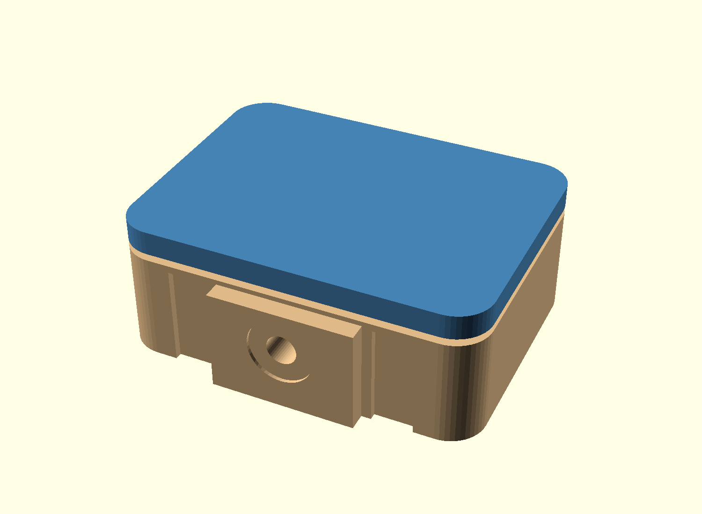
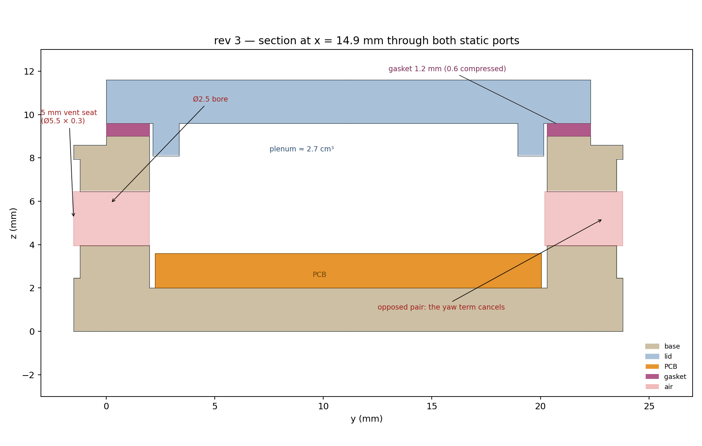
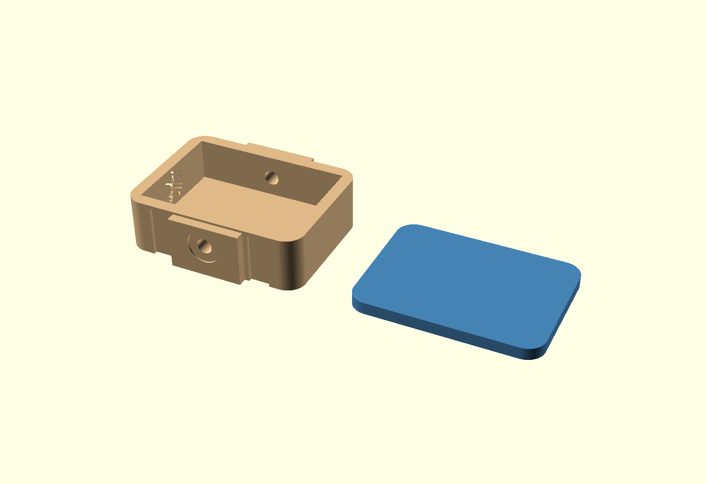

# DPS310 case — rev 3

Two printed parts, one flat gasket, two 5 mm ePTFE vent discs. Holds an Adafruit
STEMMA QT DPS310 breakout (25.4 × 17.8 mm) and gives it a pressure port that is
**sheltered, averaged and — with the discs — damped**.

| Part | Size (mm) | Print orientation |
| :--- | :--- | :--- |
| `base.stl` | 29.9 × 25.3 × 9.0 | open side up |
| `lid.stl` | 29.9 × 22.3 × 2.0 (+1.5 ring) | outside face down, ring up |
| closed | 29.9 × 25.3 × 11.6 | |







## Why there is no serpentine any more

Rev 2 tried to damp wind with a four-turn baffle box. That cannot work, and the
arithmetic is not close. The sensor chamber has one opening, so its pressure
equals the pressure at that opening — air does not have to flow through the
turns for the sensor to see a gust. Pressure arrives at the speed of sound. The
pneumatic time constant of a 2.4 mm hole into a 2.5 cm³ chamber is

    τ = R·C,  C = V/(γp) ≈ 1.7×10⁻¹¹ m³/Pa,  R ≈ 3×10⁵ Pa·s/m³  →  ~5 µs

Four baffles add microseconds and roughly 10⁻⁵ hPa of loss. They filter nothing.
A gust twenty times slower than that still passes at 100 %.

Two things do work:

1. **Put the opening where Cp is small and stable.** A port in a side wall with
   the flow parallel to it sits near Cp = 0. Two opposed ports average the
   antisymmetric yaw term, so a crosswind or a steer does not read as a pressure
   change. That is the arrangement here. The chamber itself is the manifold —
   no cross-drill is needed.
2. **Restrict the flow with a membrane.** `R_membrane × C_chamber` is the only
   way to get a real low-pass out of a part this size. A 5 mm ePTFE vent in each
   port gives roughly 0.1–0.3 s, which is a genuine filter against gusts and
   still fast enough for a 4 s grade window.

Both are worthless unless the chamber is sealed, because otherwise the real port
is the lid joint or the floor. So rev 3 seals it too. There is no header slot in
the floor any more: the board is wired by its STEMMA QT cable, which leaves
through a 6 mm hole in the −x end wall. That removes a 70 mm² opening in the
pressure boundary and lets the case sit flat on the frame.

## Numbers that matter

* 45 km/h is q = ½ρv² = 0.96 hPa ≈ 8 m of height. A single flush port at Cp = 1
  reads all of it; a port with the flow parallel reads almost none of it.
* The slope estimator is a 4 s least-squares fit with an intercept, so a *steady*
  offset cancels. What does not cancel is a changing one: accelerating 20 → 30
  km/h changes q by 0.24 hPa, ~2 m over 28 m, i.e. ~7 % apparent grade at
  Cp = 1. Keep |ΔCp| under about 0.1 and that falls under 1 %.
* Plenum volume ≈ 2.7 cm³, so C ≈ 1.9×10⁻¹¹ m³/Pa. A vent with R = 1×10¹⁰
  Pa·s/m³ (two 5 mm discs in parallel) gives τ ≈ 0.2 s. Pick the disc from its
  datasheet: R = Δp / Q at the rated point. ~25 mL/min at 100 mbar ≈ 0.2 s;
  ~5 mL/min ≈ 1 s, which is too slow for a 4 s window.

## Print

- 0.2 mm layers, 3 perimeters, 20 % infill. **PETG** for UV and water; PLA is
  fine for a fit check.
- Base: open side up. The port bores and the 6 mm cable hole are short bridges.
- Lid: outside face down. The ring grows upward; the bed side is the smooth face
  the straps bear on.
- No supports. The only deliberate overhangs are the 0.3 mm membrane-seat ledge
  and the short bores.

## Assembly

1. **Gasket.** Cut 1–1.5 mm silicone sheet (or closed-cell foam) to the lid's
   outline: 29.9 × 22.3 outside, 25.9 × 18.3 hole. Lay it on the base rim.
2. **Board.** Drop it in, STEMMA QT connector toward the −x end. Run a bead of
   neutral-cure silicone round the PCB's top edge where it meets the pocket
   wall — the plenum is sealed against the board, not against the floor.
3. **Cable.** Feed the QT cable through the 6 mm hole, plug it in, and seal the
   hole (6 mm grommet, or silicone). Strain-relieve the cable to the frame so the
   plug is not the only thing holding it.
4. **Vents.** Stick a 5 mm ePTFE vent disc in each Ø5.5 seat, adhesive side down.
   No disc = a stilling chamber only; the transients are not filtered. For a 6 mm
   disc, set `seat_d = 6.2` and `pad_h = 9.0` in the SCAD and re-export (the seat
   otherwise breaks the top edge of the pad).
5. **Lid.** Press it on. Two 3.4 mm zip ties in the side grooves, round the frame
   tube, pulled down on the lid so the gasket compresses.
6. **Mount.** Base toward the tube, lid outboard, so the straps cross the lid and
   clamp it. Ports low and to the sides, cable along the tube, long axis along
   the frame — not across it, or the ports point fore/aft. Keep it out of direct
   sun and out of the spray off the front wheel.

## Fit check

`assembly_check.scad` intersects the board and the QT connector with each printed
part, so interference is measured rather than eyeballed:

```bash
openscad -D part="none" -D show="collide"     assembly_check.scad  # board vs base
openscad -D part="none" -D show="collide_lid" assembly_check.scad  # board vs lid
openscad -D part="none" -D show="collide_qt"  assembly_check.scad  # QT vs lid
openscad -D part="none" -D show="ports"  -o ports.png  assembly_check.scad
openscad -D part="none" -D show="cable"  -o cable.png  assembly_check.scad
```

As shipped: 0.25 mm per side on the board, 5.4 mm above the PCB, the lid ring
stops 1.3 mm above a 3.2 mm QT connector, and the port bores sit 0.35 mm above
the PCB and 1.65 mm below the ring.

## Tuning

The printed part sets where the pressure is sampled and decides whether the
chamber leaks. The **vent disc** sets the time constant. There is no useful
pneumatic tuning in the plastic: a printed channel small enough to matter
(0.2 mm) clogs, and anything bigger is transparent.

To measure it, fit a short tube to one port with the other taped, push ~10 hPa
with a syringe, and watch the reading settle. The decay time is τ; a steady
offset that will not come back down is a leak. Do the same with both ports open
to check the pair.

Then ride the same flat stretch at 10, 20 and 30 km/h for 30 s each and compare
the mean pressure per band. A speed-dependent shift is Cp at the ports — check
the mounting angle before changing the print. A reading that lags the terrain by
more than a second is too much vent.

## What changed from rev 2

| | rev 2 | rev 3 |
| :--- | :--- | :--- |
| inlet | one Ø2.4 hole in the leeward end of a 6 mm box | two Ø2.5 ports, opposed, mid-length, in the sides |
| damping | four baffles (µs, no effect) | 5 mm ePTFE vent in each port (~0.2 s) |
| seal | open header slot, unlapped lid joint | solid floor, gasket, silicone, single cable hole |
| wiring | 7-pin header through the floor | STEMMA QT cable out the −x end |
| lid | 2 mm plate + 6 mm baffle box | 2 mm plate + locating ring |
| retention | one strap below the joint | two straps over the lid, compressing the gasket |
| height | 16.6 mm | 11.6 mm |
